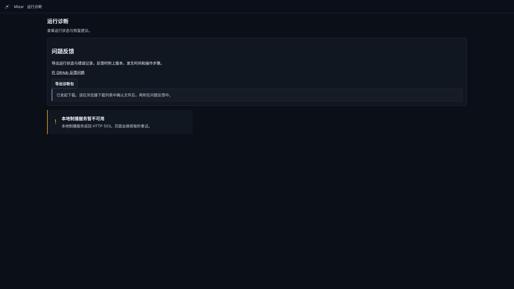

# OBS 原生支持包验证

2026-10-11，Linux + 真实 Chromium，`tests/acceptance/support-export.spec.ts`。

此截图对应正常 UI 下载真实 Companion allowlist 导出，`snapshot.nativeObs.collectionStatus=unsupported`。浏览器其他服务请求隔离为 503，以防误用共享现场服务；诊断包请求实际调用测试进程中的 Companion，断言新字段、256 KiB 上限与凭据不外泄。另四项浏览器测试覆盖下载重试、模拟 Desktop 保存及 Host 查询失败/超时。

Windows 原生进程查询、CS2 hook 和实际画面未在实机跑过。Windows 文件/进程边界的单元测试使用受控 fixture，不能据此声称用户黑屏已修复。原始 1.3.1 支持包没有 OBS 原生日志，新增采集器无法追补缺失的历史。
