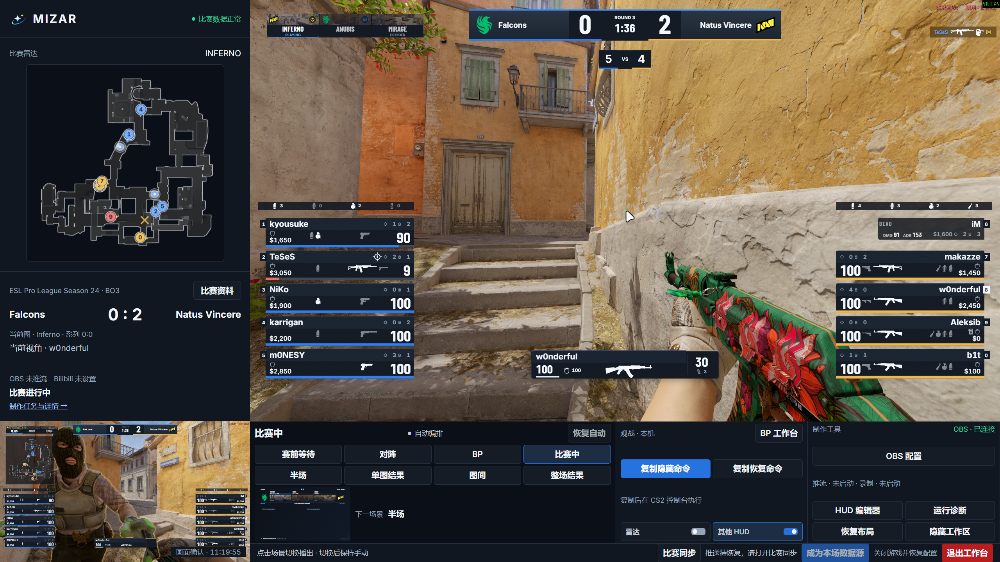
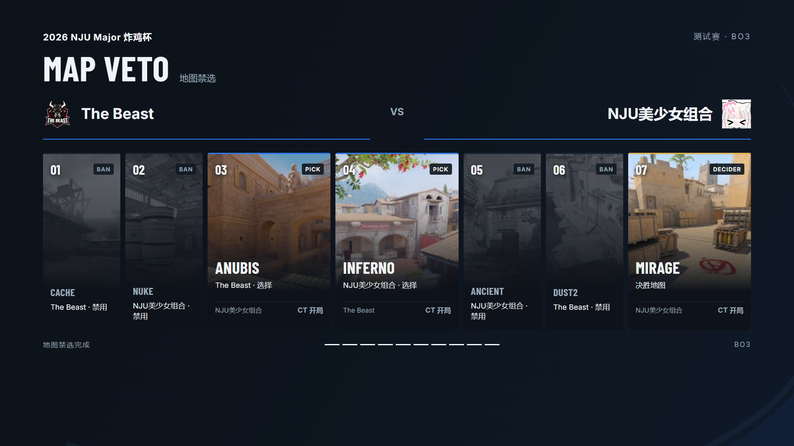
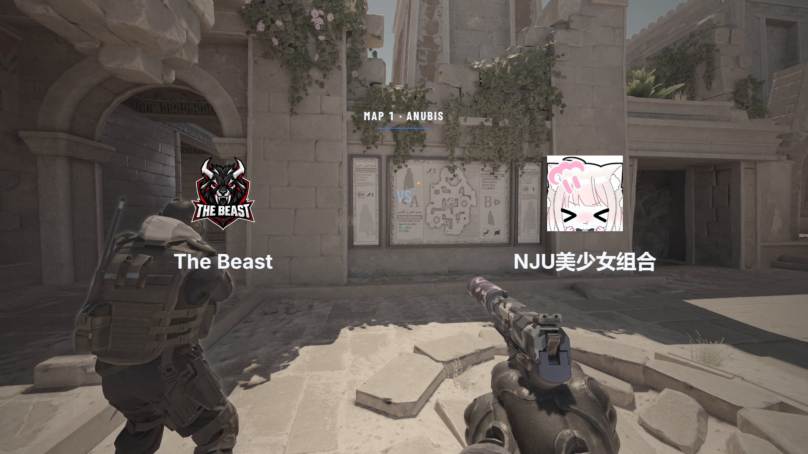
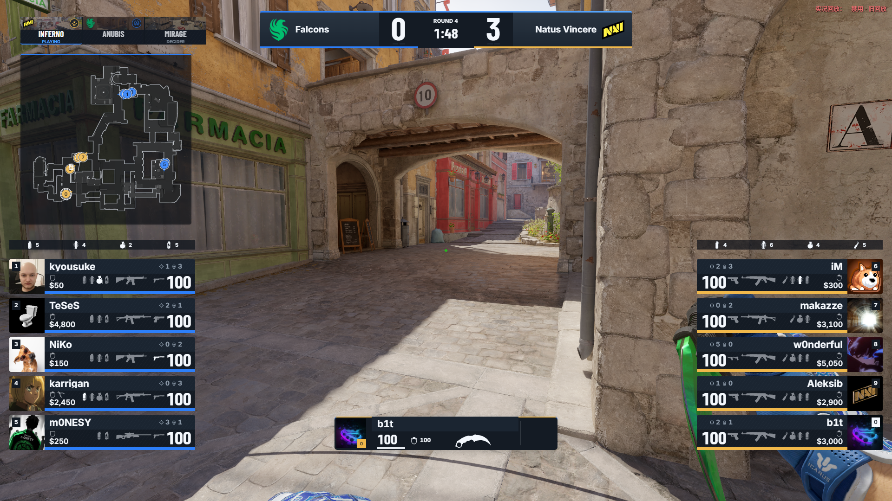
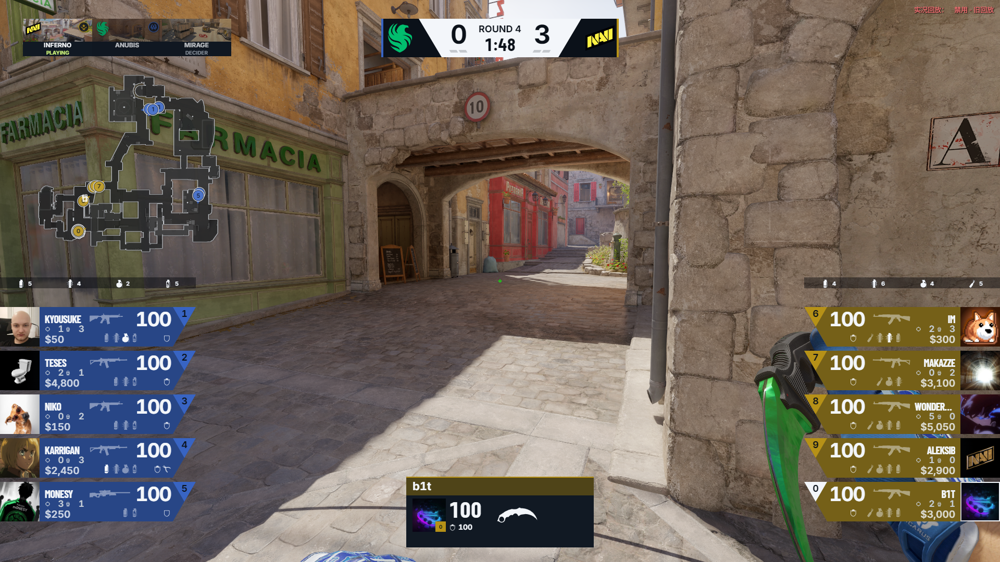
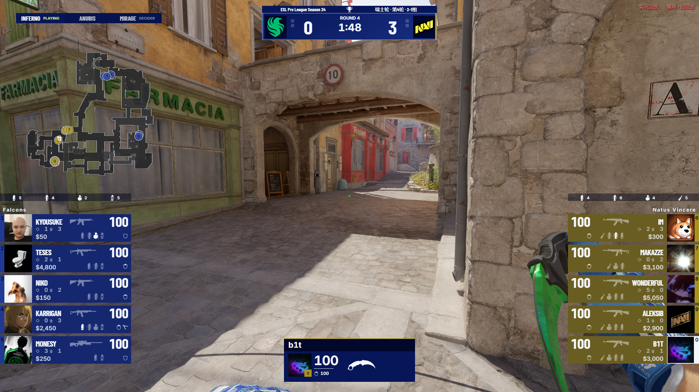
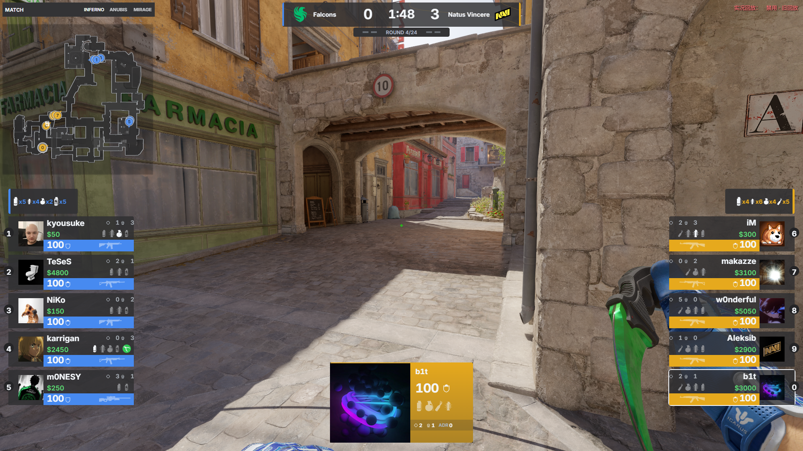
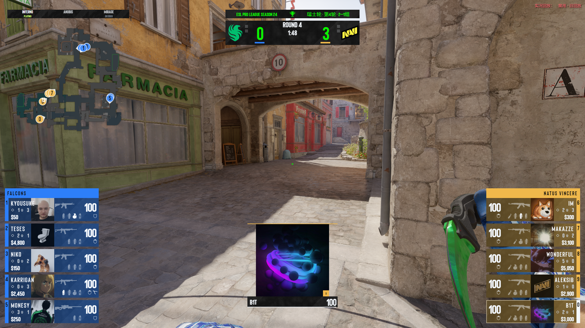

# 产品画面

[比赛库统一布局的最新对照](shared-match-library/README.md)：本地与 RivalHub 使用同一组件和详情布局，包含同一份资料的 2K 对照、候选编辑、创建与缓存缺失状态。比赛库评审优先看这组。

[PR #413 合入最新 main 后的最新 2K 图集](pr413-main-review/README.md)：覆盖新增页面、全部设置分区与五项收尾优化，含长页面补图、来源和讨论建议。优先使用这组截图评审当前页面；下面的旧图集保留其原始拍摄状态。

[查看 16:9 桌面界面图集](desktop-16x9/README.md)：本场准备、资料、设置、HUD／BP 与现场工作台的 2K 浏览器截图。

## 制播工作台

真实游戏画面、大雷达、比赛资料与制作控制集中在同一屏幕。

## 地图禁选与对阵开场

地图禁选依次展开，随后通过对阵动画进入局内画面，形成连贯的节目开场。

[观看地图禁选动图](program-veto.gif)

[观看 BP → 对阵动画 → 局内 HUD 的完整衔接](program-opening.gif)

## HUD 风格

Mizar Pulse 提供从赛前到赛后的统一节目包装；其余预设提供各具特色的局内 HUD。通过编辑器调整组件、布局与外观，让画面契合自己的赛事。

### Mizar Pulse

### EWC

### IEM

### Perfect World

### ESL

操作步骤见[HUD 预设与文件分享](../guide/quick-start.md#hud-预设与文件分享)，图片来源与摘要见[图集元数据](provenance.json)。
