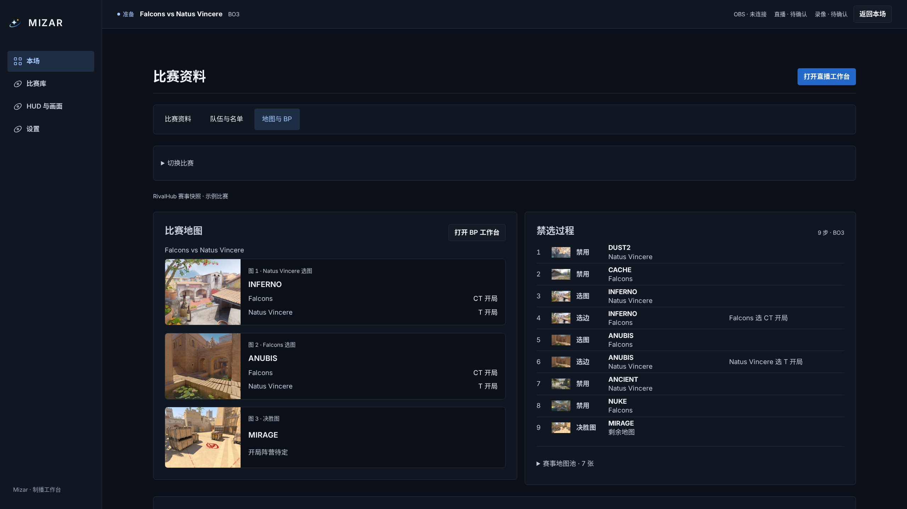
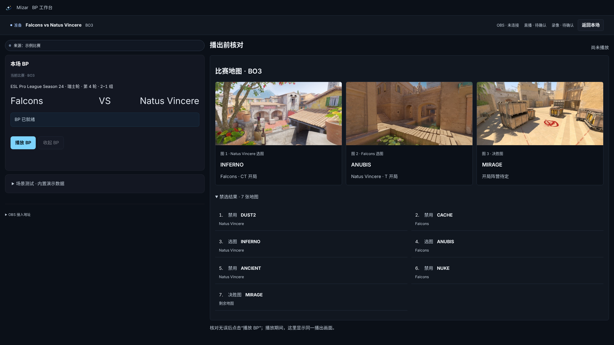
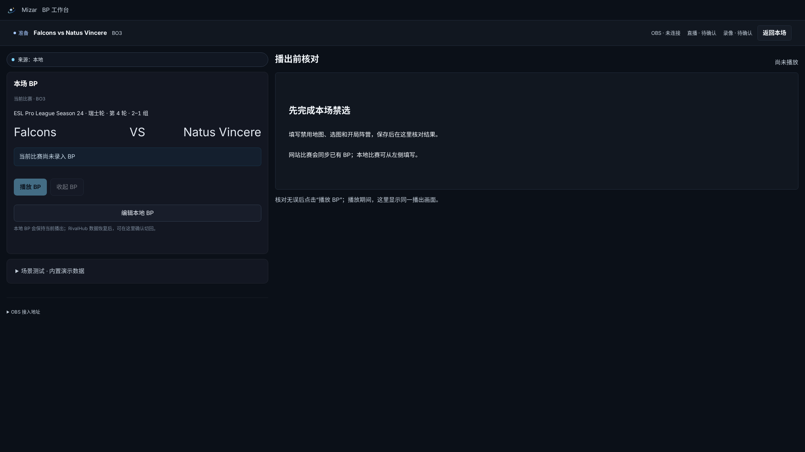
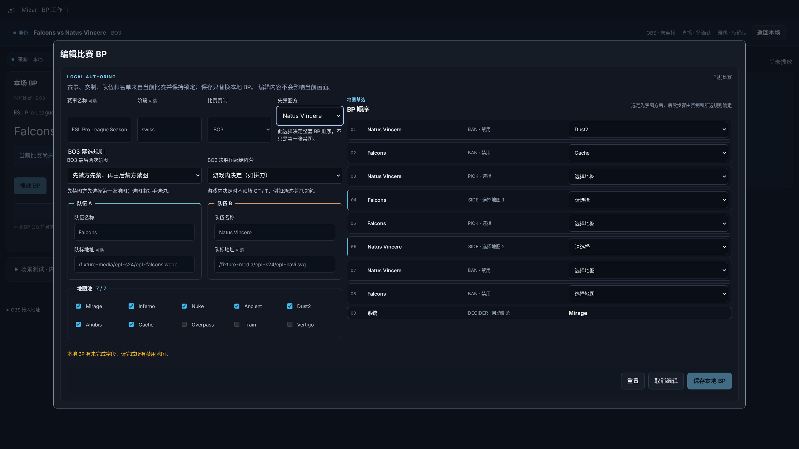
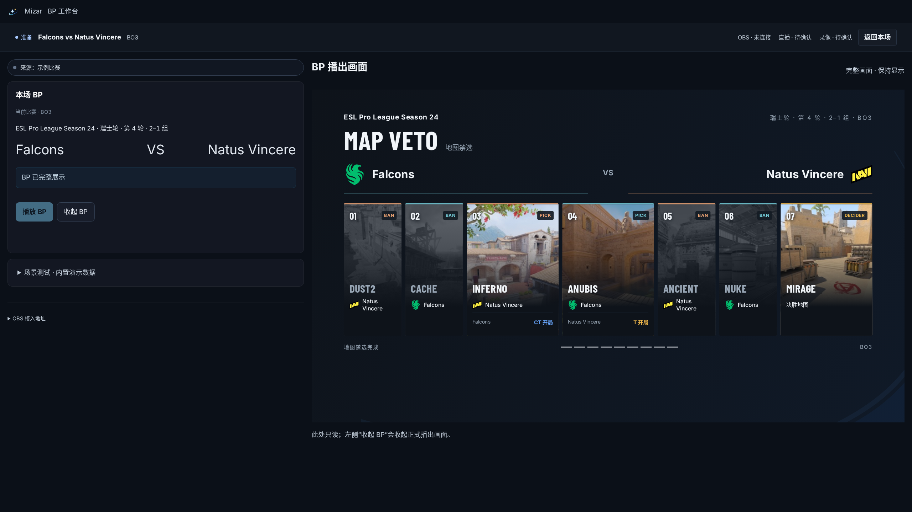

# 地图与 BP 第一轮打磨

2560×1440 实际应用完整视口截图。比赛资料来自 EPL 样例；工作台状态通过浏览器读取接口模拟，未发送正式播放命令。右侧播出图由现有 BP 渲染器生成，未接入真实 OBS。

流程：查看地图与禁选 → 打开 BP 工作台 → 必要时填写并保存 → 核对地图结果 → 播放 → 收起。编辑和保存沿用现有实现；未播放时展示资料摘要，播放时显示同一播出状态的只读预览。

本轮完成 Web 类型检查、ESLint、design:check，以及 BP 本地填写/保存/重启恢复浏览器回归。截图检查无页面异常，未录入时禁止播放，已显示时允许收起。

## 地图与 BP：地图顺序和禁选过程

## 已完成，播出前核对

## 尚未录入 BP

## 填写中：已完成前两次禁图

## 完整 BP 正在展示

