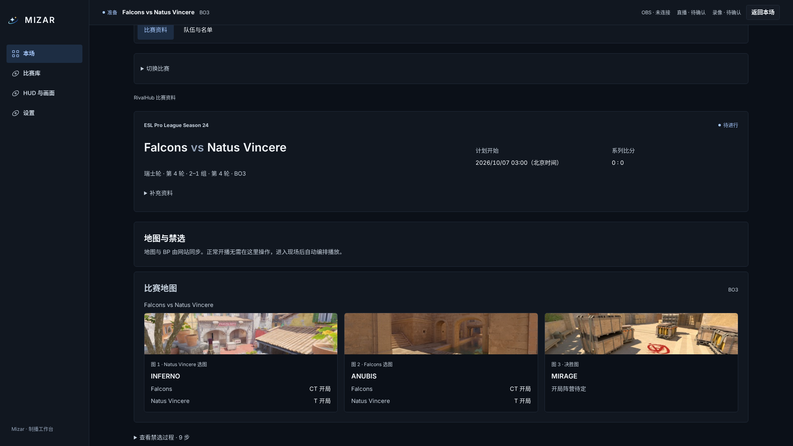
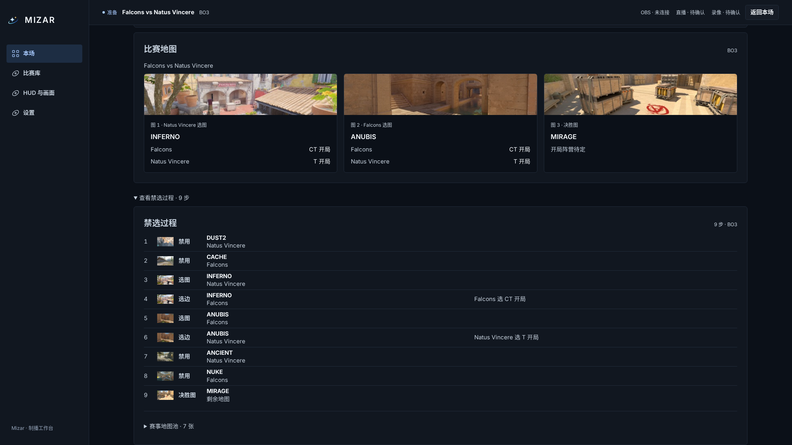
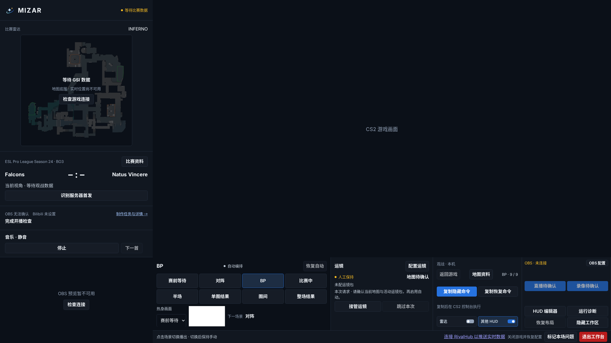
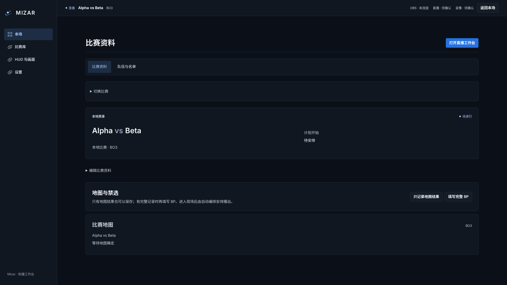
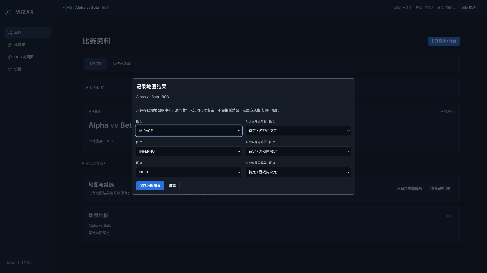
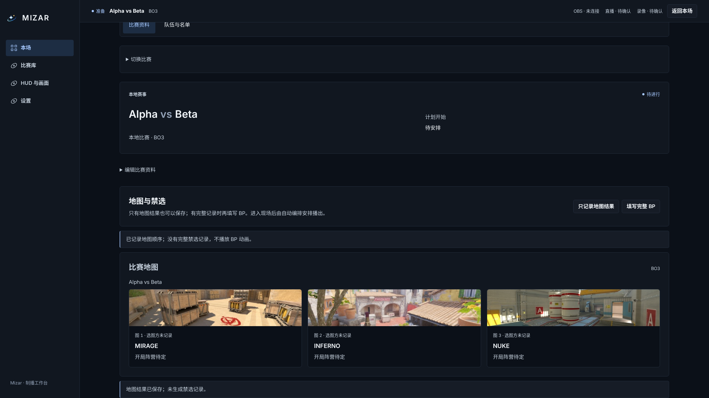
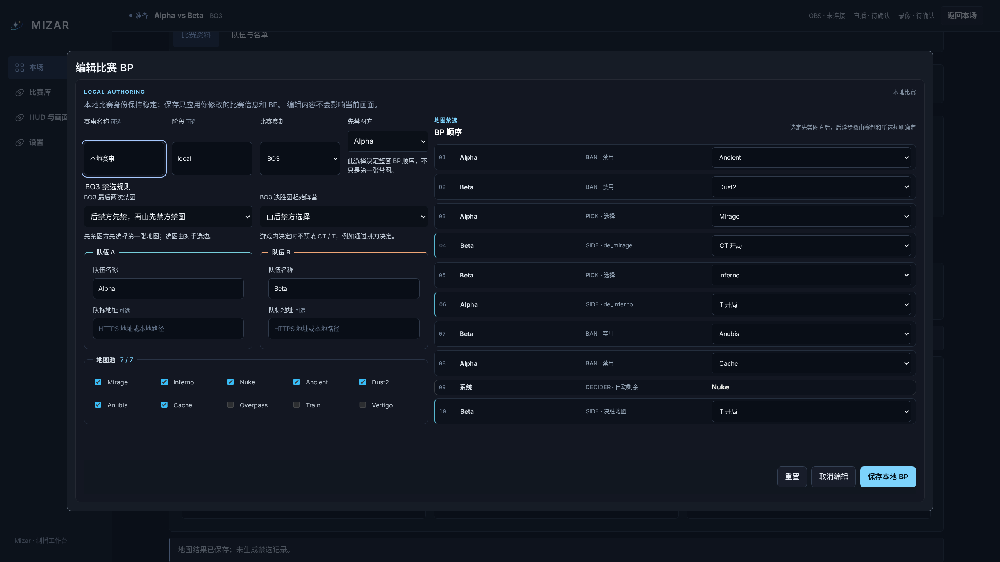
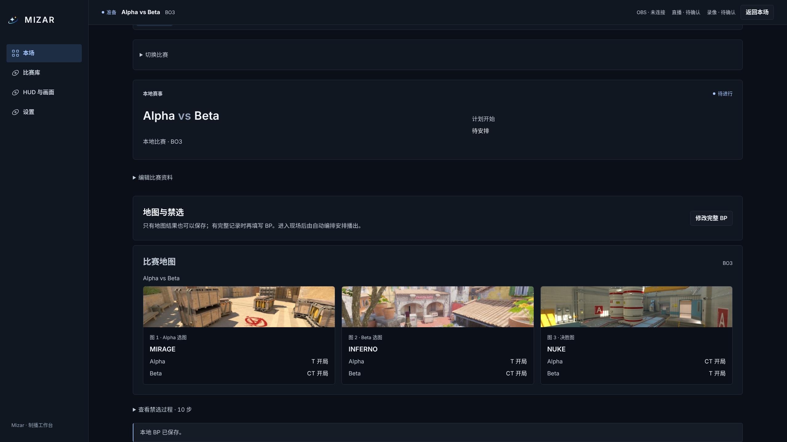

# 地图与 BP：网站、本地两种工作流

实际应用截图，页面视口为 2560×1440、deviceScaleFactor=1，不使用长截图。详情页允许正常滚动，截图展示地图区域。HUD 沿用正式播出的 1920×1080 原生透明画布；09 是实际地图条元素截图。

## 网站比赛

比赛库选择并载入本场 → 比赛详情自动同步地图/BP（可直接跳过）→ 进入工作台，由自动编排播放。需要更正时在网站修改，Mizar 不提供本地覆盖入口，保存接口也拒绝覆盖。

比赛库、载入确认见[比赛库工作流](../library-workflow/README.md)。

## 本地比赛

创建本地比赛（队名、赛制）→ 同一比赛详情中选择：

- 只记录地图结果：填写已知地图，起始边可全部留空。保存后 HUD 显示地图顺序，没有虚构的选图方和 BP 动画。
- 填写完整 BP：弹窗填写禁选顺序，保存后返回比赛详情；完整有效的 BP 供现场自动编排播放。

创建入口见[创建本地比赛](../library-workflow/03-create-local.png)。没有禁选记录时不显示空的禁选折叠栏。

## HUD 空值表现

[完整透明 HUD 画布](08-hud-map-fallback.png)。只缺起始边不会影响地图名称和顺序；实时比赛 CT/T 来源独立，不从未知的 BP 起始边推断。

## 验证边界

本地截图来自浏览器验收测试和隔离的真实 Companion 接口，覆盖地图保存、null 起始边、无 BP projection、完整 BP 保存、重启恢复、退出编辑保护与播放。网站、现场自动编排状态及 HUD 使用模拟读取数据，不写真实网站。现场截图没有 CS2/OBS 画面，不代表 Windows 原生联调完成。

Web/Companion 类型检查、修改文件 ESLint/Prettier、design:check、相关 7 项单元/接口测试和浏览器流程验收。`checks.json` 记录截图来源与视口。

本地截图复现：`MIZAR_CAPTURE_BP=1 PLAYWRIGHT_PORT=4175 pnpm exec playwright test --config=playwright.acceptance.config.ts tests/acceptance/bp-presentation.spec.ts`。

截图脚本在模拟 HUD WebSocket 时记录了一次连接关闭事件（见 checks.json）；地图条渲染断言通过，相关 HUD 空值测试通过。此截图不用于证明实时连接稳定性。
