# 16:9 桌面界面

所有图片均为 2560×1440 的完整浏览器视口，不是长截图。比赛资料与雷达来自仓库 EPL 样例，HUD 为同源实景回放，BP 为独立的内置 BO3 演示。游戏槽位为占位，OBS 与运镜未连接；这组图展示产品界面，不代表 Windows / CS2 / OBS 实机验收。

[来源与文件摘要](provenance.json) · [界面与缩放规则](../../design/ui-system.md#169-桌面工作面)

[本场准备](#01-本场准备) | [比赛资料](#02-比赛资料) | [队伍与名单](#03-队伍与名单) | [地图与 BP](#04-地图与-bp) | [播出画面](#05-播出画面) | [HUD 编辑器](#06-hud-编辑器) | [BP 工作台](#07-bp-工作台) | [游戏设置](#08-游戏设置) | [OBS 连接](#09-obs-连接) | [音乐配置](#10-音乐配置) | [运镜配置](#11-运镜配置) | [赛事平台](#12-赛事平台) | [高级设置](#13-高级设置) | [现场工作台](#14-现场工作台)

## 01 本场准备

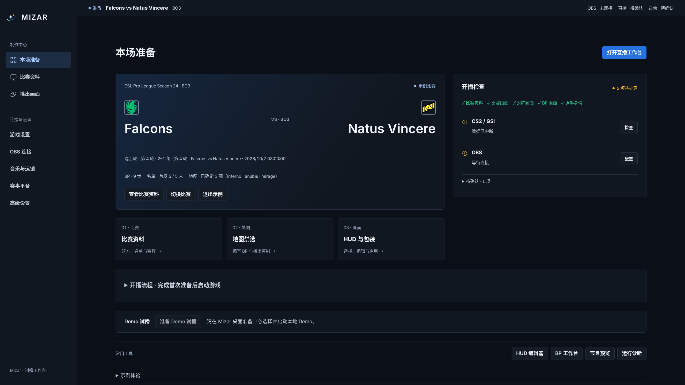

## 02 比赛资料

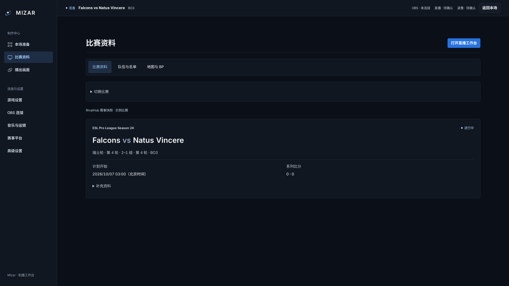

## 03 队伍与名单

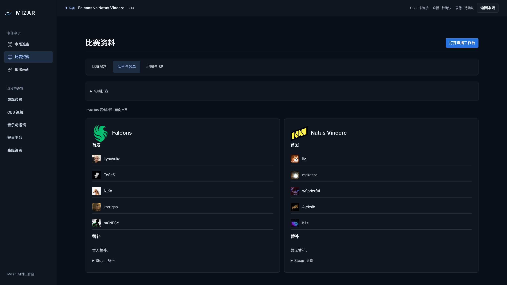

## 04 地图与 BP

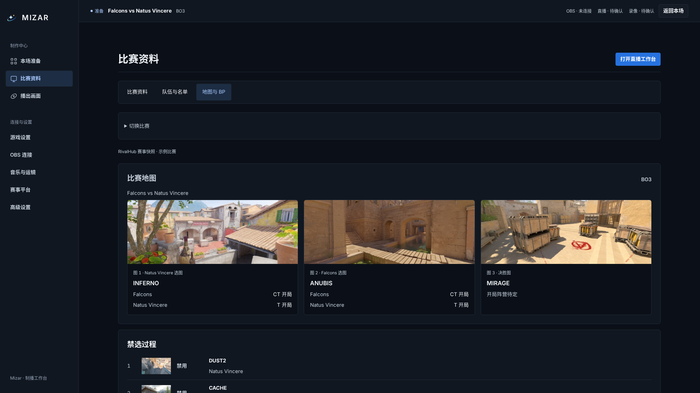

## 05 播出画面

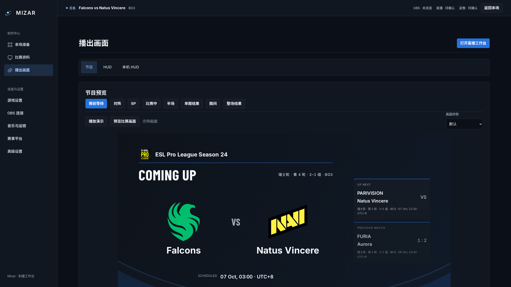

## 06 HUD 编辑器

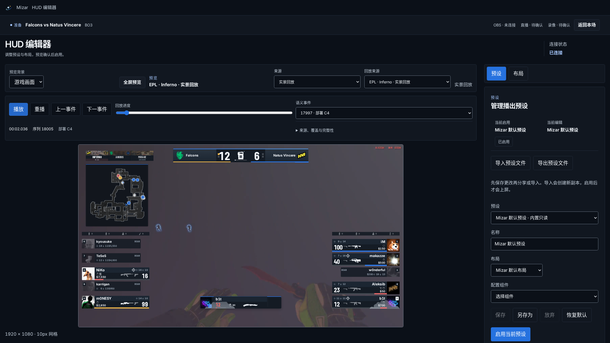

## 07 BP 工作台

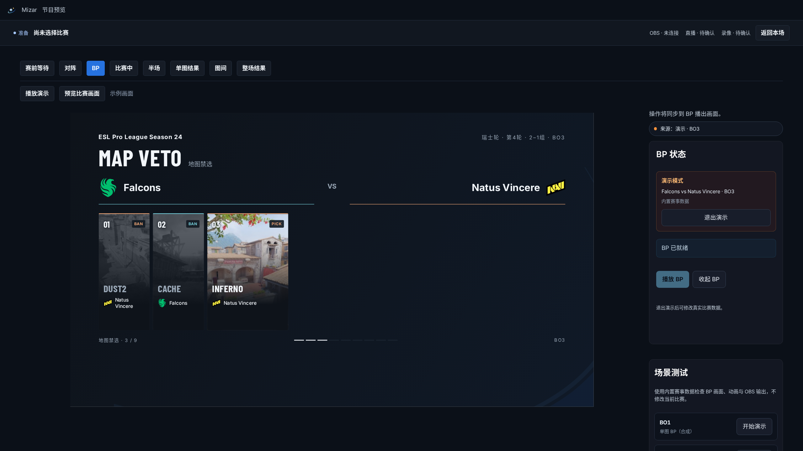

## 08 游戏设置

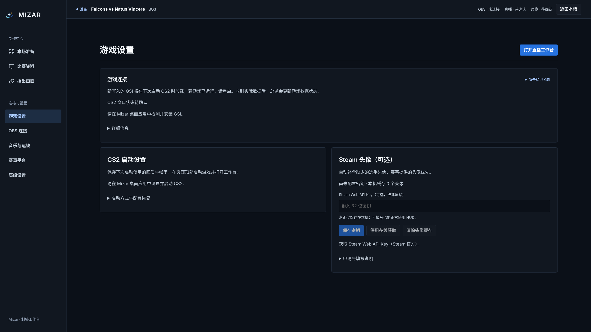

## 09 OBS 连接

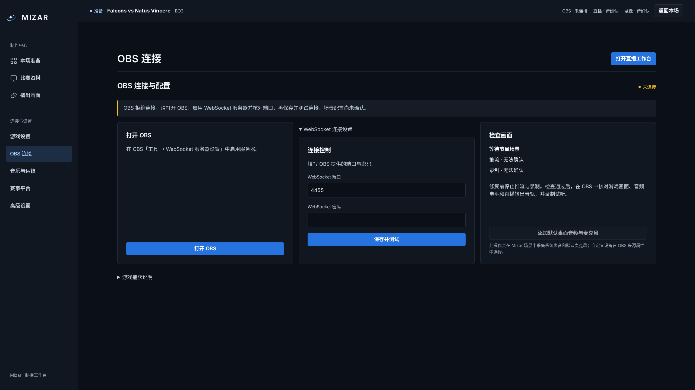

## 10 音乐配置

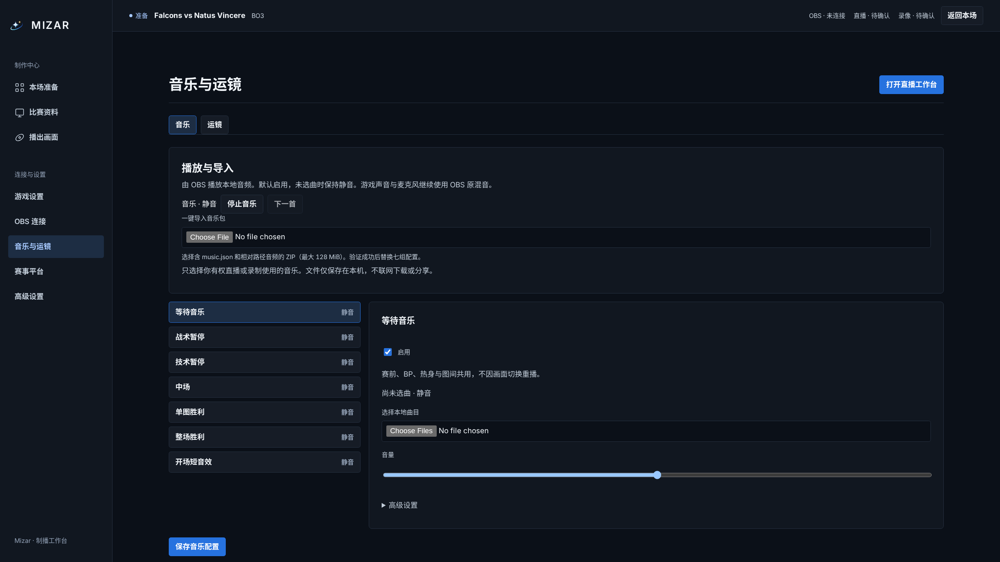

## 11 运镜配置

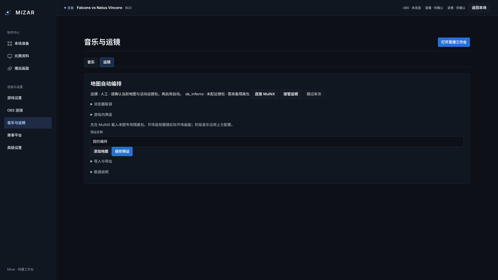

## 12 赛事平台

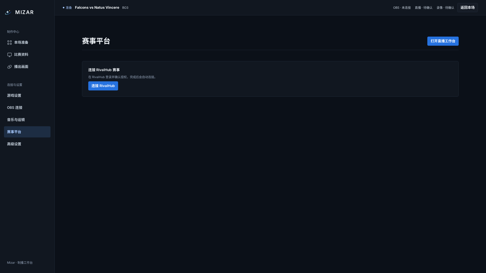

## 13 高级设置

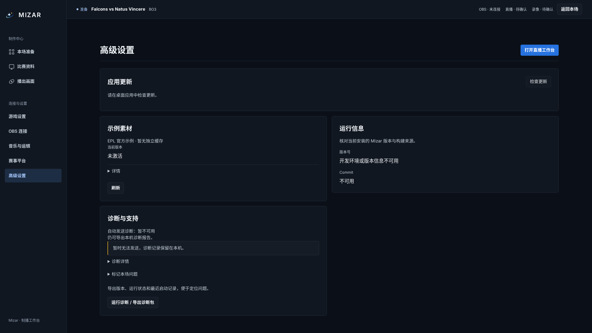

## 14 现场工作台

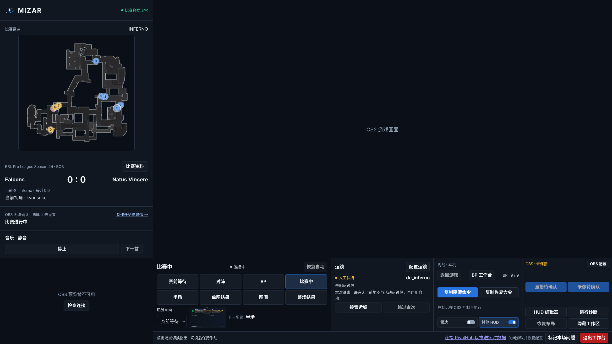

