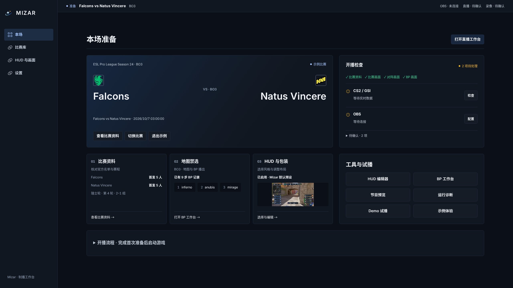
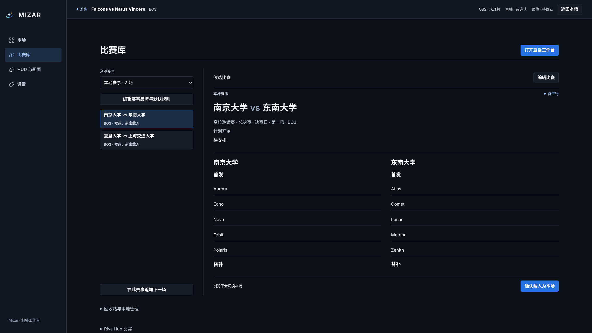
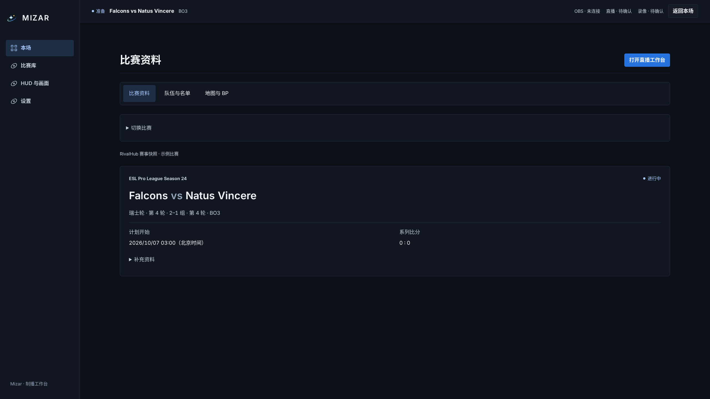
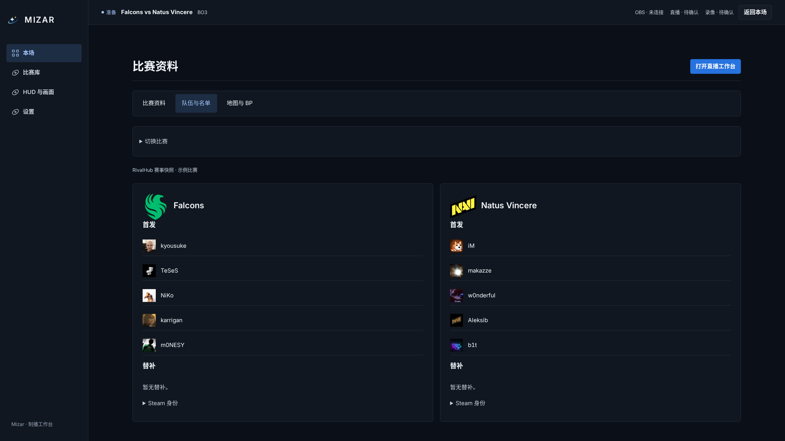
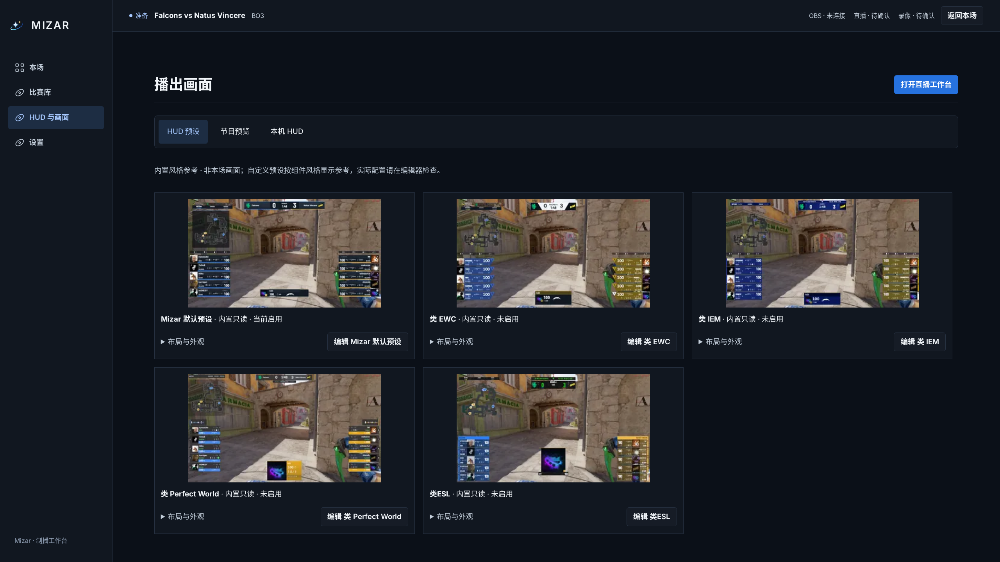
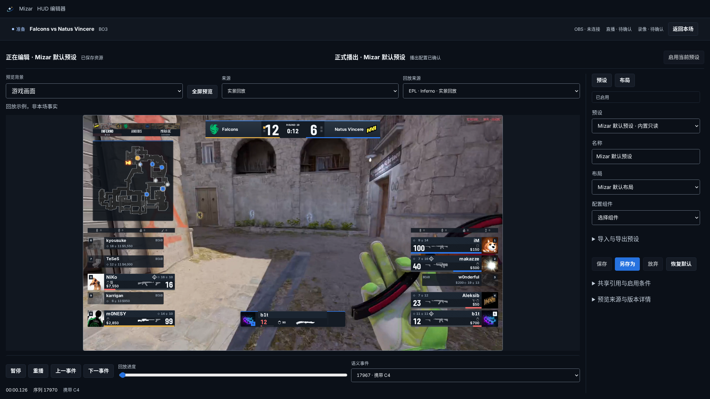
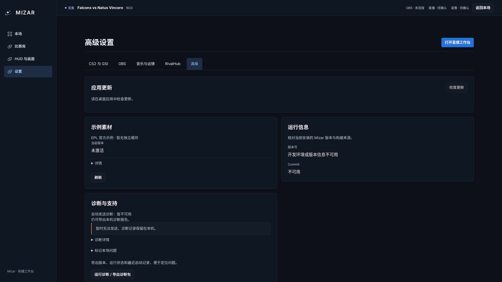
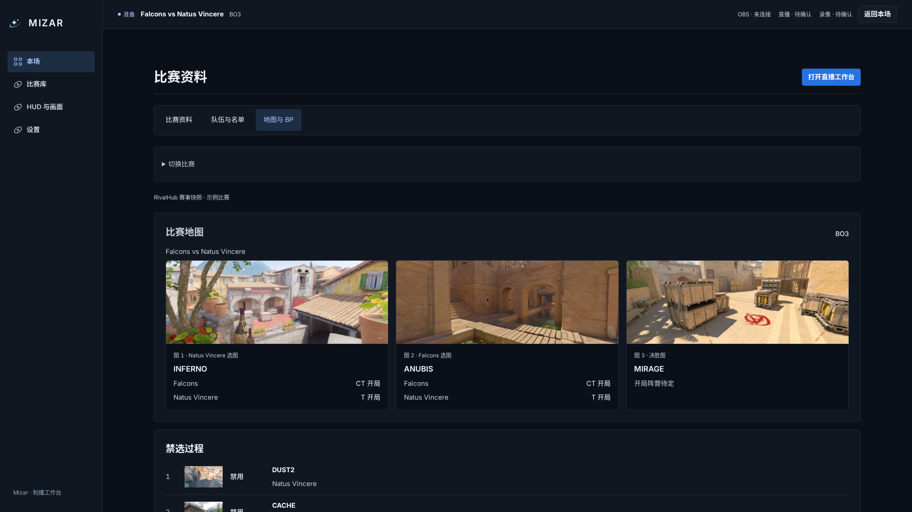
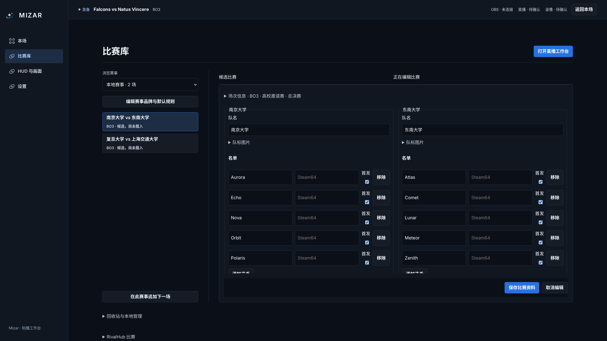

# 16:9 桌面界面

本轮截图为实际应用的 2560×1440 浏览器完整视口（`fullPage: false`），基于 PR #413 的后续修改。融合两份设计包、PR #246 的比赛库与编辑器方案，以及当前主线已有能力；没有直接合并旧分支。

本场资料来自仓库 EPL 样例；比赛库中的高校比赛与名单是通过真实本地接口创建的演示资料；HUD 使用同源实景回放。雷达展示地图底图，未接入实时 GSI；右上游戏为占位，OBS 与运镜未连接。这些截图不代表 Windows / CS2 / OBS 实机验收。

[缩放实测](scaling.json) · [页面尺寸与运行错误记录](geometry.json) · [文件摘要](provenance.json)

[比赛库与现场首发的最新 8 种状态](../library-workflow/README.md)

[地图与 BP 最新五种状态](../bp-polish/README.md)

## 本场准备

## 比赛库

## 比赛资料

## 队伍与名单

## HUD 预设目录

## HUD 编辑器

## BP 工作台

## 游戏设置

## OBS 连接

## 音乐配置

## 运镜配置

## 赛事平台

## 高级设置

## 现场工作台

## 地图与 BP

## 候选比赛编辑

