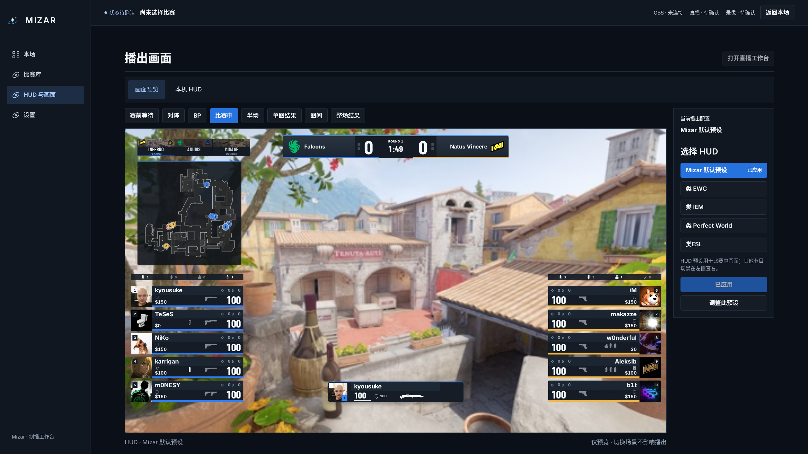
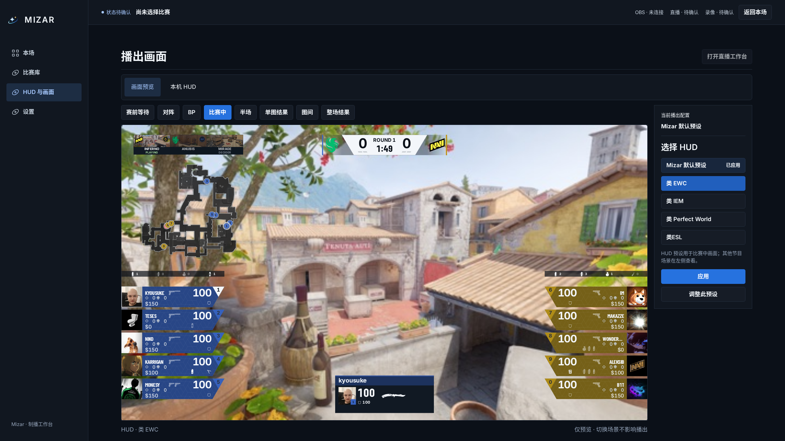
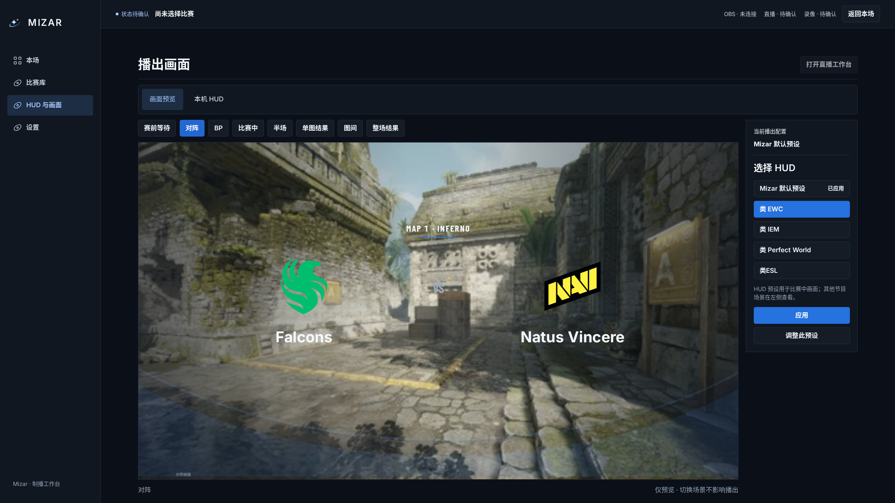
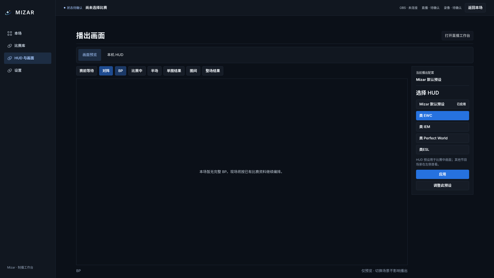
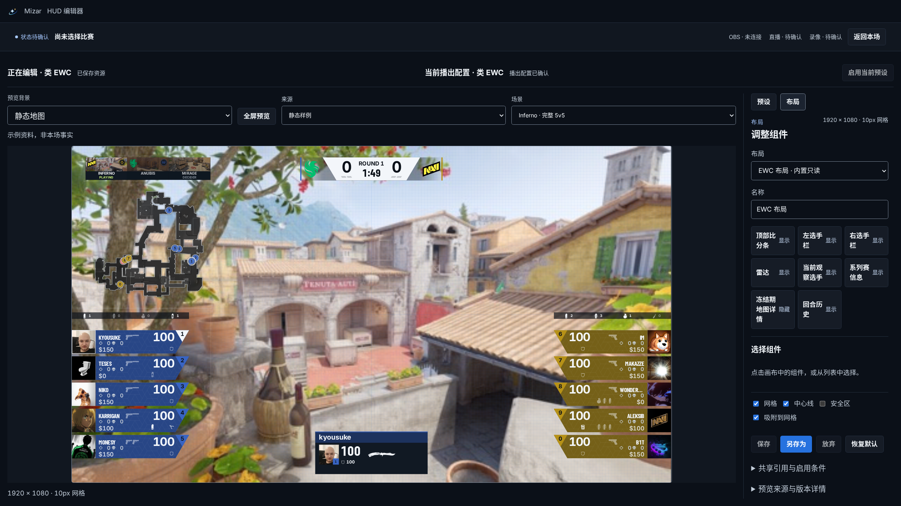

# HUD 与画面：选择、预览、应用

沿用配置：从本场直接进入工作台，不必访问此页。

更换 HUD：打开画面预览 → 右侧选择预设 → 左侧直接查看实际组件、布局与外观 → 点击「应用」。选择和切换场景都不会写入播出配置。当前播出配置与正在预览的选择分别呈现。

检查整套节目：在同一个 16:9 区域切换等待、对阵、BP、比赛中、半场及结果。HUD 预设只改变比赛中画面，不暗示其他节目主题也会随之切换。完整 BP 可以只读展示，无需发出播放命令；没有完整记录时明确留空。

调整：点击「调整此预设」，打开对应预设的现有编辑器，保存与启用继续分开。

## 页面流程

## 验证

截图为真实应用 2560×1440 视口，非长截图。使用仓库 EPL 样例及隔离 Companion 配置存储；未选择真实比赛、未连接 OBS/CS2，截图顶部如实显示未选择比赛。对阵截图展示开场动画中的对阵阶段，非节目最终输出验收。

浏览器验证选择/切场不发送配置写入、显式应用更新实际后端、打开所选编辑器、断连禁用应用；1920×1080、2560×1440、3840×2160 下预览保持 16:9，完整画面、底部说明与调整按钮均在首屏。保留原编辑器保存、重启恢复、启用与 Program 输出回归。Web 类型检查、修改文件 ESLint/Prettier 和 design:check。

复现：`MIZAR_CAPTURE_HUD=1 PLAYWRIGHT_PORT=4175 pnpm exec playwright test --config=playwright.acceptance.config.ts tests/acceptance/hud-customization.spec.ts --grep 'picture selection'`。
