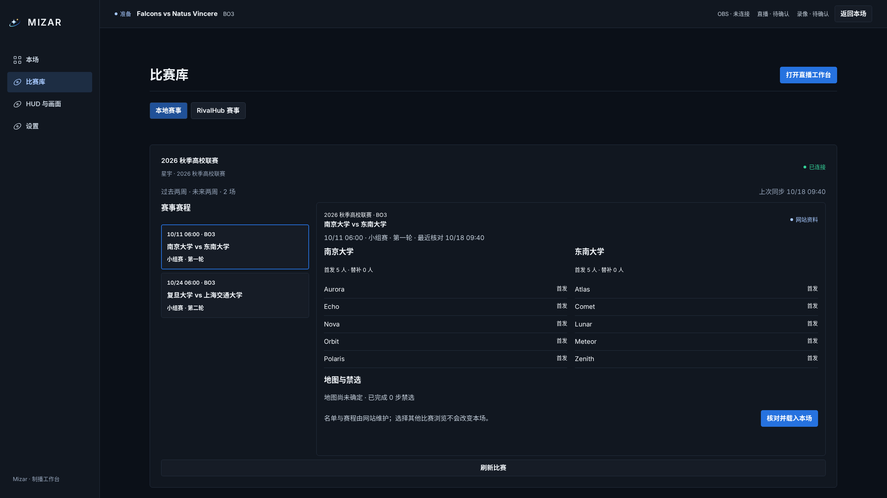
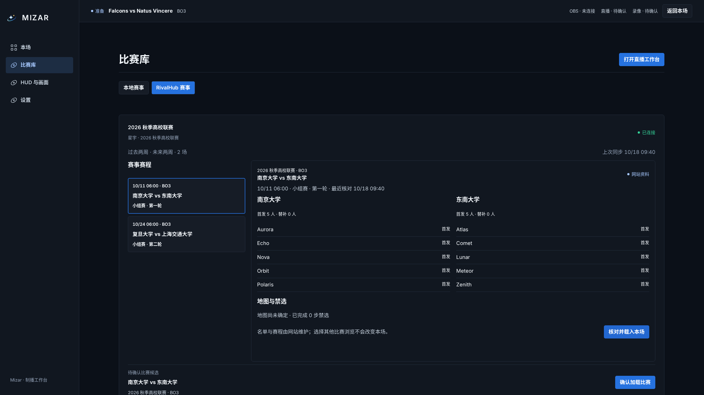
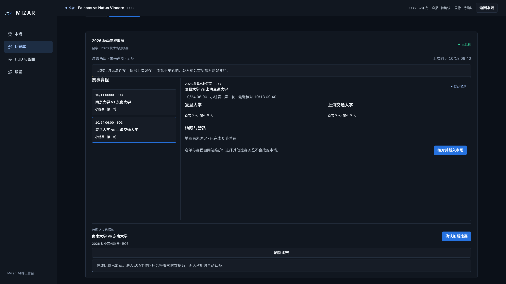
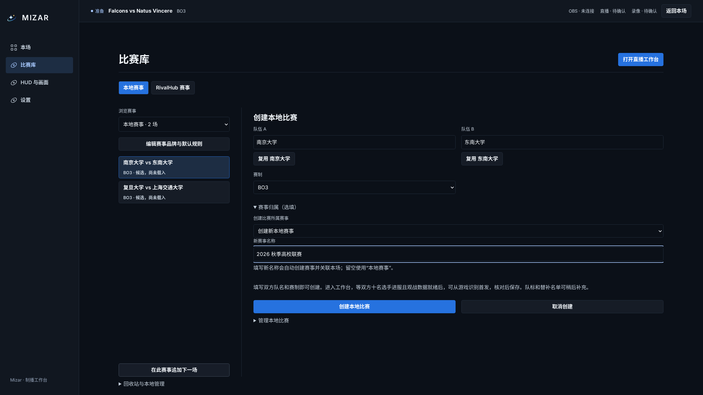
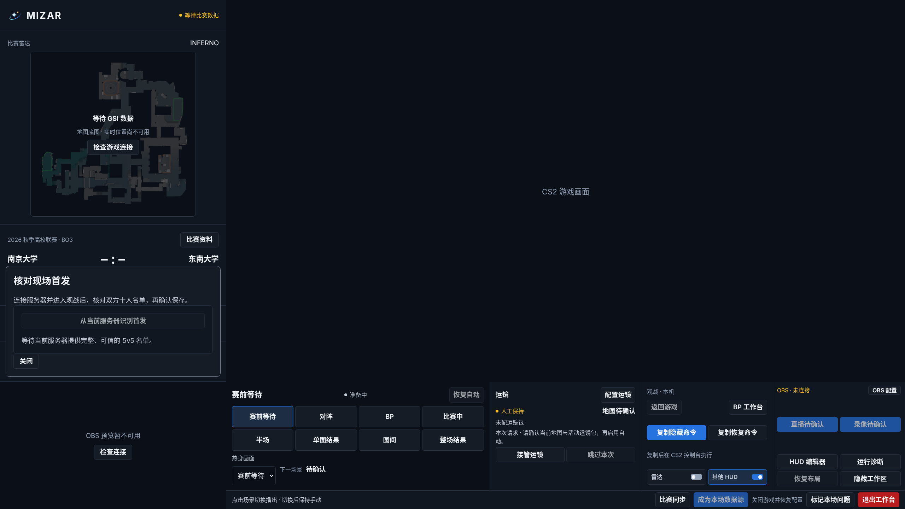
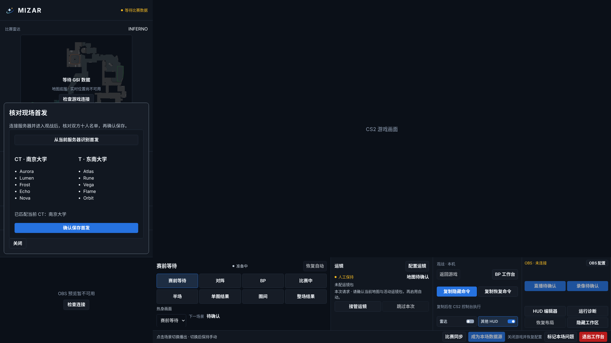
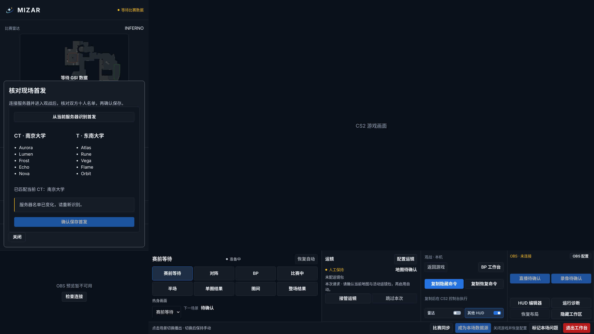
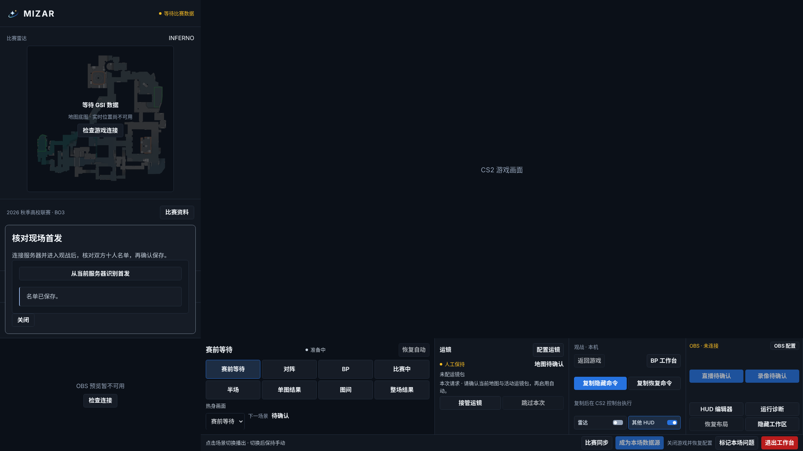

# 比赛库与现场名单工作流

实际应用的 2560×1440 完整视口截图。网站赛程和现场十人名单通过浏览器 HTTP / WebSocket 模拟；写入被拦截。没有操作真实网站、游戏或 OBS，不代表 Windows 原生窗口联调。

网站流程：授权赛事 → 缓存前后各两周 → 浏览单场 → 在线核对候选 → 确认载入。断网仍能浏览已有缓存。

本地流程：填写队名、赛制 → 可选赛事归属 → 创建 → 进入工作台 → 等十人进服且观战数据就绪 → 识别首发 → 核对 CT/T → 确认保存。名单变化会禁用旧预览，重新识别后才能保存。

创建表单明确说明可在工作台从游戏取得首发，队标和替补名单可稍后补充。现场面板仅覆盖左上区域，可关闭；游戏、OBS 预览与底部控制台保持可用。

[浏览器断言与三分辨率边界](checks.json) · [截图来源与摘要](provenance.json)

## 网站比赛库：赛程、名单与地图

## 网站候选：核对后确认载入

## 网站断网：保留缓存

## 创建本地比赛：最少填写与现场名单说明

## 现场：等待十人观战数据

## 现场：核对双方首发

## 现场：名单变化，旧预览不可保存

## 现场：重新识别并保存

