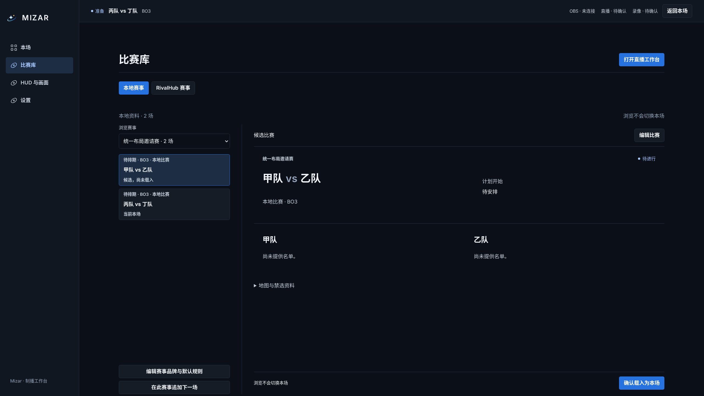
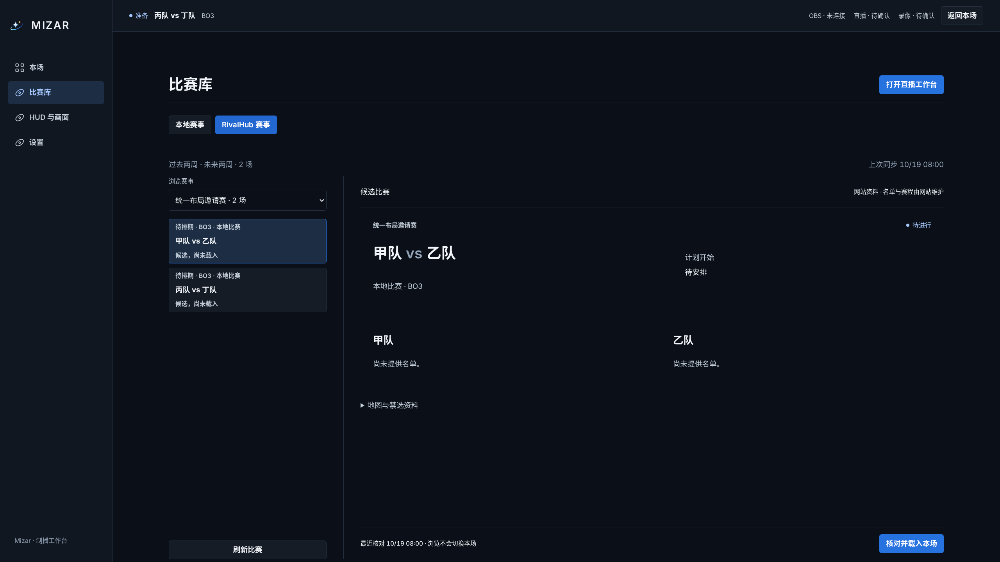
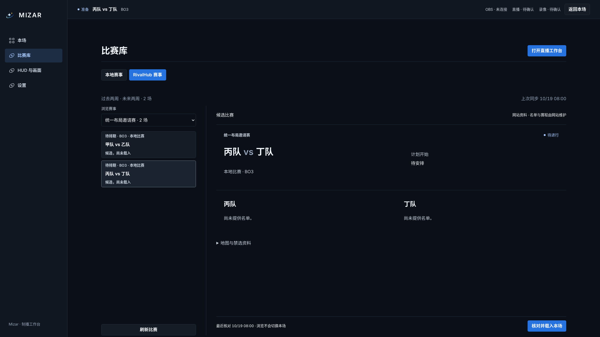
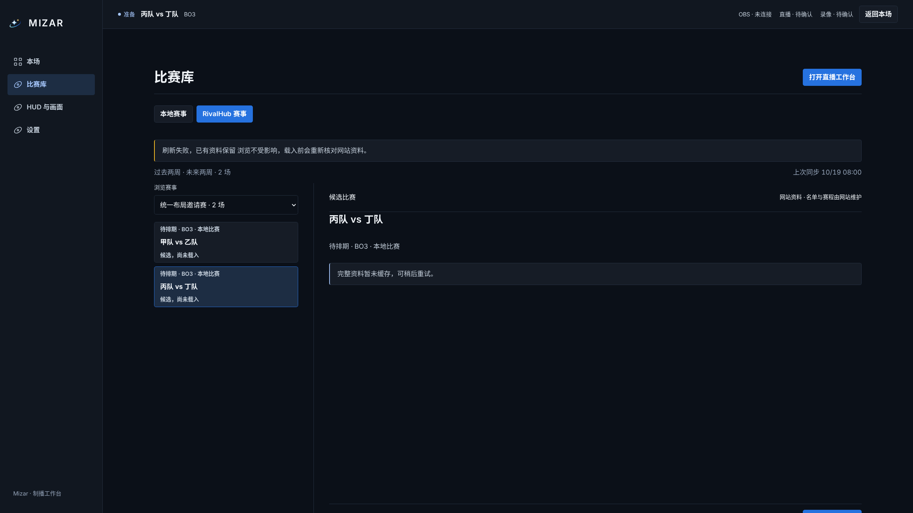
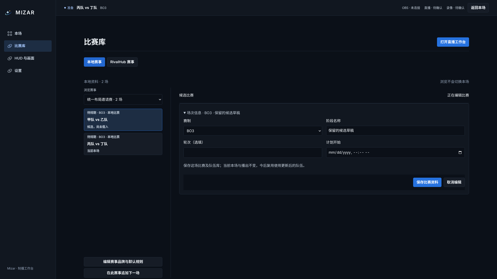
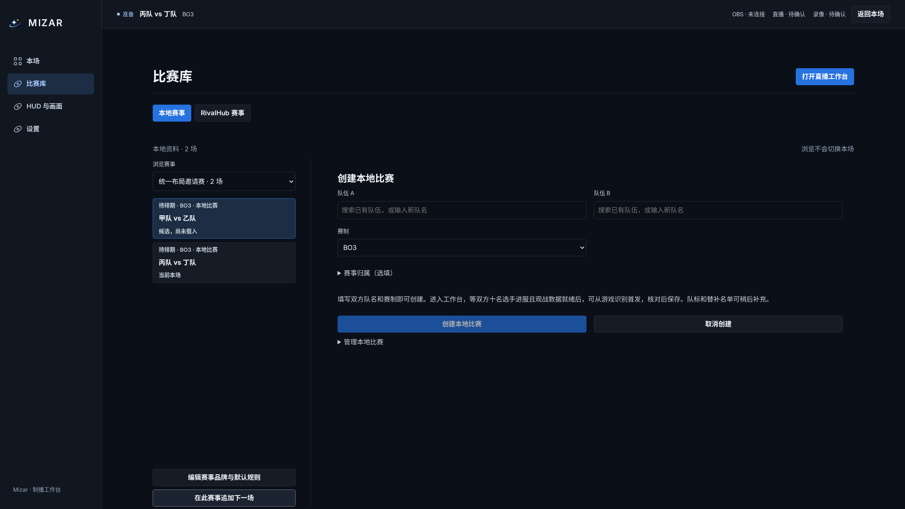

# 本地与 RivalHub：统一比赛库布局

2026-10-19（北京时间），源码 `9b19497349d5b3d7aa5f7f03e03421a77aff8628`。6 张截图均为 **2560×1440、16:9、完整浏览器视口**，未裁切或合成。[来源与摘要](provenance.json)

两种来源现在共用 `LibraryWorkspace` 展示赛事选择、场次列表、详情区域和底部操作栏；通过 `LibraryMatchDetails` 共用比赛摘要、名单人数与地图／BP 展示。移除网站版额外的外框、详情边框和另一套名单样式。列表统一显示时间、赛制、阶段及当前／候选状态，底部固定保留显式载入操作。

本地创建与编辑、网站请求与缓存仍由各自负责模块处理；它们把数据与操作传给共同组件，不再各自维护一套浏览布局。授权与连接管理继续在 RivalHub 设置页显示。

01 和 02 刻意使用**相同赛事、两场比赛、同一份候选资料**。来源差异仅为本地编辑／创建入口、网站刷新／核对时间与网站资料提示。真实本地接口负责创建和编辑；网站边界使用明确模拟，不代表真实网站加载或实机制播验收。

验证通过：17 项组件／无障碍检查，Web 与根目录类型检查、修改范围 ESLint／Prettier、全仓构建，以及本地制作与共同比赛库两项浏览器验收。浏览器覆盖浏览不载入、点击后请求正确的比赛、刷新与缓存缺失、来源切换后本地草稿保留，并继续通过原有候选保存不切本场断言。

## 本地比赛：候选详情

## RivalHub：同一比赛详情

## RivalHub：浏览下一场，未载入

## RivalHub：完整缓存缺失与刷新失败

## 本地候选：切换来源后草稿仍保留

## 本地比赛：在当前赛事追加下一场

